# IMPLEMENTED

What is done, step by step, in the format of [IMPLEMENTATION.md](IMPLEMENTATION.md).

## Step 00: before this plan
- Done (what existed when the plan started; all of it uncommitted on `feat/more-engines`):
  - Glutter v1.9.9 as the UI toolkit (`go.mod`).
  - `internal/model`: the contract between formats and app (`Format`, `Document`, `Value`, `Site`, `Edit`) and `model.WriteFile` (temporary file, rename, first version kept as `.bak`).
  - The Ren'Py format on the model: `internal/pickle` and `internal/renpysave` (`Format`, `Document`, keys and signatures), and the app on the model (`app.go`, `tree.go`, `main.go`, `formats.go` with `supportedFormats()` holding only `renpysave.Format`).
  - Finished format packages, not yet registered in `supportedFormats()`: `internal/gvas` (Unreal GVAS), `internal/lcf` (RPG Maker 2000/2003 `.lsd`), `internal/rubymarshal` with `internal/rgss` (RPG Maker XP, VX, VX Ace; `rgss.Formats`).
  - Unfinished packages: `internal/jsondoc` (JSON document layer, tests pass), `internal/rpgmv` (RPG Maker MV and MZ; four tests failed, see Step 01), `internal/unityprefs` (Unity PlayerPrefs, tests pass), `internal/nrbf` (.NET BinaryFormatter; builds, has no tests and only a `testdata` folder).
- Supported / not supported: see SPEC.md section 2. Only Ren'Py is registered and reachable from the app at this point.
- Checks: not run as a whole before Step 01.
- Verified against: see Step 01.
- Screenshot: none (nothing to show that Step 01 does not show).
- Open questions: none.

## Step 01: Baseline
- Done:
  - `go mod tidy`: `golang.org/x/text v0.43.0` moved from indirect to direct, `glutter` v1.9.9 (`go.mod`, `go.sum`).
  - Baseline of the whole repository: `go build`, `go vet`, `gofmt` and `golangci-lint` were clean as found. The only failures were four tests (and subtests) of `internal/rpgmv`; they are marked with `t.Skip("known failure ... step 03")` in `internal/rpgmv/document_test.go` and nothing else of that package was touched:
    - `TestLayerOfLZStringFourteen`: the lz-string 1.4 layout is not detected (`layout 0`); skipped as a whole.
    - `TestEdits/int`: editing `party._gold` (a JsonEx `$ref` to a Game_Party also reached through the first actor) fails "another value changed": the edit does change the shared value (the dump shows 9.9999999e+07 under the actor's party, where the object is first written), but the test's expectation writes the new value under `party`, which is only a `$ref`. So either the test's `setDump` does not follow `$ref`/`@r`, or the model does not present the shared value at both paths; Step 03 decides. Only that subtest is skipped.
    - `TestParseErrors/MV_empty` (route `...decodeMV->lzDecompressFromBase64.LZStringCorrupt` instead of `ParseMV->decodeMV.LZStringCorrupt`) and `TestParseErrors/MZ_corrupt` (tag `RpgmvMZText` instead of `RpgmvMZInflate`); only those two subtests are skipped.
  - `internal/nrbf` has no tests (Step 05); it builds and vets.
  - Started this file.
- Supported / not supported: no behavior changed. The app still opens Ren'Py saves only; gvas, lcf, rgss, rpgmv, unityprefs and nrbf are not registered (Steps 02 to 06). Skipped, to be fixed in Step 03: the four tests above. Also skipped on this machine (they need something that is not installed here, and nothing was installed): `TestAgainstPython`, `TestSampleAgainstPython` and `TestEditedFilesAgainstPython` of `internal/rgss` (they need the Python module `rubymarshal`), `TestLZStringAgainstJavaScript` and `TestFixturesAgainstTheEngine` of `internal/rpgmv` (they need the engines' own scripts given by path).
- Checks (all on the whole repository):
  - `gofmt -l .`: no output.
  - `go vet ./...`: no output.
  - `golangci-lint run`: 0 issues.
  - `go test -race ./...`: all packages ok (before the skips: `internal/rpgmv` failed).
  - `CGO_ENABLED=0 go build ./...`: ok.
  - `CGO_ENABLED=0 go test ./...`: all packages ok.
  - `pgrep -a` for Xvfb and save-editor: nothing left.
- Verified against: the Ren'Py path is checked against Python by `internal/pickle` tests (`load.py`, python3 3.13 installed here, they ran and passed) and `internal/renpysave` tests; the Step 01 changes touch no format code, so nothing new needed an independent check. The skipped tests above are the checks that could not run here.
- Screenshot: 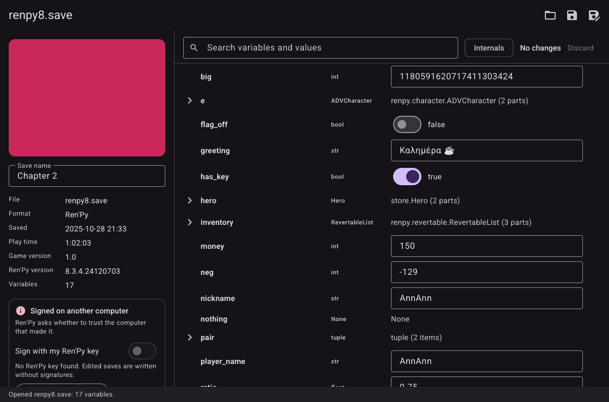 (real binary, `CGO_ENABLED=0` build, private Xvfb, `HOME` in a scratch folder, `GLUTTER_SCREENSHOT_AFTER=2s`, on `internal/renpysave/testdata/renpy8.save`: 17 variables, strings with non-Latin text, switches, the signature card).
- Open questions for the manager:
  - Skipping versus leaving the four rpgmv tests failing: I skipped them so the Definition of done is green, with the step number in each skip message; `grep -rn "step 03" internal/rpgmv` finds them all. Say if you prefer another marking.
  - The `rubymarshal` Python module is third-party and absent, so three rgss tests skip. Should Step 02 add a check against an independent reader that needs no install?

## Step 02: Register the finished formats
- Done:
  - `formats.go`: `supportedFormats()` now returns Ren'Py, `gvas.Format`, `lcf.Format`, then `rgss.Formats...` (XP, VX, VX Ace). Ren'Py stays first (an existing test requires it). Nothing else in the app needed a change: the open dialog filters, the empty page's format list and Save as come from the registered formats.
  - `registered_test.go` (new): one table of 14 fixtures (3 Ren'Py, 3 GVAS, 4 LSD, 4 RGSS). `TestRegisteredFixturesAreDetectedByTheirOwnFormat` checks that exactly one registered format detects each fixture, that it is the expected one, and that `openDocument` parses it with variables and details. `TestRegisteredFixturesOpenAndSaveInTheApp` opens each (except the two extra Ren'Py fixtures, which only have the detection check) in the app, checks the page shows the file name, format name, a detail and a variable, expands the rows down to an int, types a new value, saves with the save button, parses the saved file with the format, and checks that every leaf value of the tree is as before except the edited one, and that `<file>.bak` holds the original bytes. Ints edited: Ren'Py `money`, GVAS `Level`, LSD `title/hero_hp`, XP/VX `Graphics.frame_count`, VX Ace `$game_system/@save_count`.
  - `go.mod`/`go.sum` unchanged in this step.
- Supported / not supported: the app now opens Ren'Py `.save`, Unreal GVAS `.sav`, RPG Maker 2000/2003 `.lsd`, XP `.rxdata`, VX `.rvdata` and VX Ace `.rvdata2`, edits and saves them. Not registered yet: RPG Maker MV/MZ (Step 03), Unity PlayerPrefs (04), .NET BinaryFormatter (05), Unity JSON / Easy Save 3 (06). The GVAS pattern `*.sav` and the later NRBF pattern `*.sav` overlap by name; detection is by contents, which Step 05 must keep true. Cosmetic issue seen in the screenshots, not fixed (it is in the row text of `tree.go`, outside this step): a container with one part reads "(1 parts)" (VX Ace screenshot).
- Checks (whole repository, with `RUBYMARSHAL_PYTHON` set where noted):
  - `gofmt -l .`: no output.
  - `go vet ./...`: no output.
  - `golangci-lint run`: 0 issues.
  - `go test -race -count=1 ./...` with `RUBYMARSHAL_PYTHON` set to the existing venv at `.../scratchpad/venv-rm/bin/python`: all packages ok. The rpgmv skips of Step 01 are still in place.
  - `CGO_ENABLED=0 go build ./...`: ok. `CGO_ENABLED=0 go test -count=1 ./...`: ok.
  - Golden image `testdata/goldens/editor.png`: not changed by this step (still the modification from before the plan; the golden test passes).
  - `pgrep -a Xvfb` and `pgrep -a save-editor`: nothing left.
- Verified against: the Python package `rubymarshal` (a venv that already existed, nothing installed): `go test -v ./internal/rgss ./internal/rubymarshal` with `RUBYMARSHAL_PYTHON=.../venv-rm/bin/python`, none of the Python tests skipped and all pass: `rgss` `TestAgainstPython` (xp.rxdata, xp-extra.rxdata, vx.rvdata, ace.rvdata2), `rubymarshal` `TestSampleAgainstPython` and `TestEditedFilesAgainstPython` (all edit cases). GVAS and LSD have no independent reader here (they are checked against the `.expected` files and the format's own tests); the app tests of this step are not independent checks.
- Screenshots (real binary on the fixtures, private Xvfb, `HOME` in a scratch folder):
  - GVAS, `ue4.sav`: 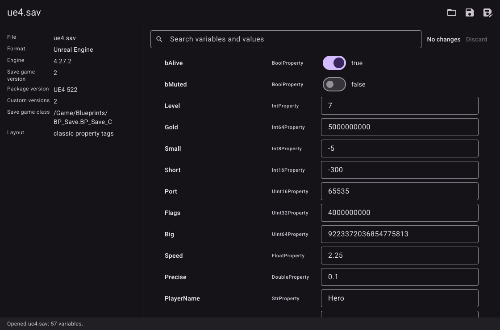
  - LSD, `rm2k3_cp1252.lsd`: 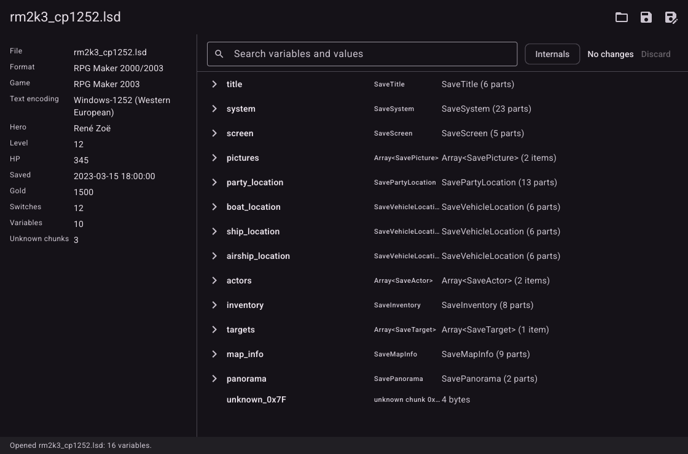
  - VX Ace, `ace.rvdata2`: 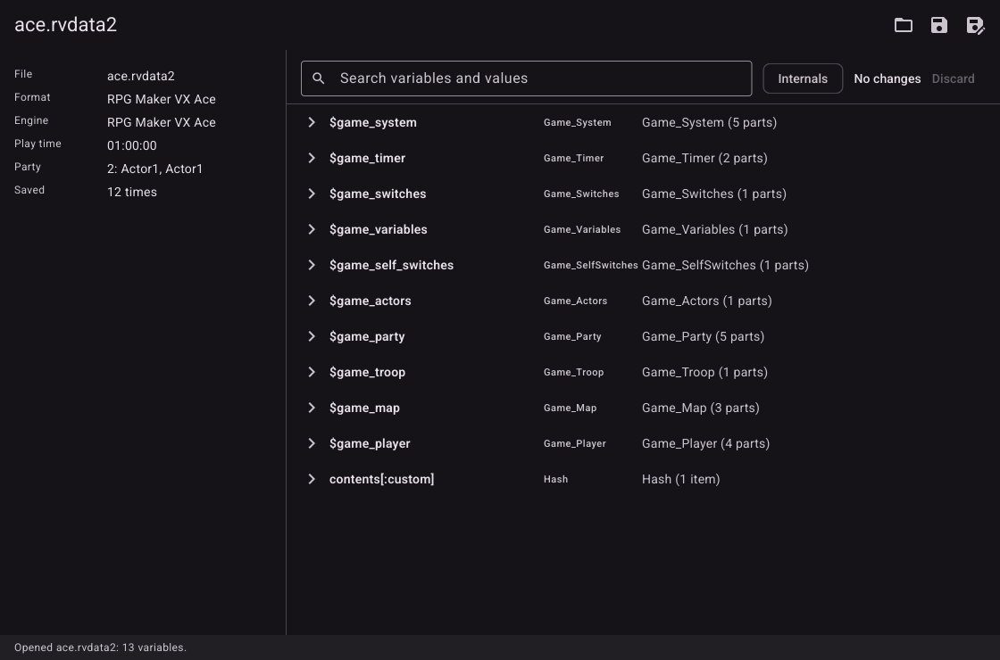
  All three show the file, the format, the document's details and the tree, with no Ren'Py parts (no save name, no signature card) and no screenshot picture. The Internals chip is absent for GVAS (no internal variables) and present for LSD and VX Ace.
- Open questions for the manager:
  - "(1 parts)" in `tree.go`: fix it in Step 07 (the app step) or now?

## Step 03: RPG Maker MV and MZ
- Done:
  - `internal/rpgmv/layers.go`: `decodeMV` now tells the two LZString layouts apart. Both layouts carry the same bit stream and differ only in the padding of the last bits, so either decodes the other's file (this is why `TestLayerOfLZStringFourteen` saw layout 0). The layout is the one whose `compressToBase64` of the text gives the file back; a file neither gives back is of the MV layout. A file of lz-string 1.4 or later is therefore written back in its own layout.
  - `internal/rpgmv/document.go`: the detail "Format" was renamed "Packing" ("LZString, Base64" and "zlib, written as UTF-8 text"); the app already shows a "Format" row, and the page showed two.
  - `internal/jsondoc/doc.go`: an error returned by a site's `CheckText` is now tagged with `errors.NewErr` (it comes from outside the package) instead of `errors.New(..., err.Error())`; the message is the same.
  - Registered `rpgmv.FormatMV` and `rpgmv.FormatMZ` in `formats.go` (after the RGSS formats).
  - Tests: every "step 03" skip removed (`grep -rn "step 03" internal` finds nothing). `TestEdits/int` was a bug of the test, not of the code: the dump of the engine's graph holds a shared object once, where it is first met (`actors._data[1]._party`), and `{"$ref": n}` elsewhere, so the expected value was put into a `$ref` at `party`. The test now finds the first place of the edited site (`pathOfSite`) and expects the new value there; the edit itself reads back through `party._gold` and the shared value changed everywhere, as the engine reads it. `TestParseErrors/MV_empty` expects the route `ParseMV->decodeMV->lzDecompressFromBase64.LZStringCorrupt` (the constructor is in the failing function, as CLAUDE.md says). `TestParseErrors/MZ_corrupt` flipped a byte of the UTF-8 file, which made invalid UTF-8 (tag `RpgmvMZText`); it now flips a byte of the zlib stream and writes it as UTF-8 again, which is the corrupt stream the test meant (`RpgmvMZInflate`).
  - New tests: `TestMZWritesTheZlibStringAsUTF8` (below), `TestDamagedFilesNeverPanic` (every prefix of every fixture and every fixture with each byte changed, through `Detect`, `Parse`, `Details` and `Encode(nil)`), `TestDamagedTextNeverPanics` in `internal/jsondoc`, and `registered_test.go` now has the six MV/MZ fixtures (detected by exactly one format; opened in the app; an int edited, saved, read back with every other value unchanged, `.bak` the first version).
  - Fixed in the test code: `fmt.Errorf` in `internal/jsondoc/jsondoc_test.go` (CLAUDE.md forbids it).
  - Review of `internal/jsondoc` and `internal/rpgmv` against SPEC.md and CLAUDE.md: every error is made once with `errors.New`/`errors.NewErr` in the failing function, every tag is a constant at the end of its file's group and has a test asserting its route (jsondoc: Syntax, TooDeep, EditSite, EditKind, EditRange, EditFloat, EditText, EditTwice; rpgmv: NotMV, NotMZ, MZText, MZInflate, MZDeflate, MZLarge, LZStringCorrupt, LZStringSurrogate); no `fmt.Errorf`, no cgo, no `runtime.GOOS`, no global mutable state, every exported identifier has a doc comment, parse then `Encode(nil)` gives the original bytes, an edit keeps the kind and is bounded by the site (default: the JavaScript safe range), the text is only patched (white space, key order and spelling of unedited numbers and strings stay), a decompression bomb is bounded (`maxUnits`, `maxInflated`).
- How MZ writes its zlib string on disk, decided from `rmmz_managers.js` (read, not run): `StorageManager.jsonToZip` is `pako.deflate(json, {to: "string", level: 1})`, a JavaScript string with one character per byte of the zlib stream (the header is `78 01`); `saveToLocalFile` gives it to `fs.writeFileSync(path, zip)`, which has no encoding argument and so writes the string as UTF-8, a byte of 0x80 or more taking two bytes; `fsReadFile` reads with `{encoding: "utf8"}` and `pako.inflate` gets the string back. `decodeMZ` reads each UTF-8 character as one byte (a character above U+00FF, or invalid UTF-8, is `RpgmvMZText`), and `encodeMZ` writes zlib level 1 the same way. `TestMZWritesTheZlibStringAsUTF8` checks, on the three MZ fixtures (made by the engine's own code): the file's size is the stream's plus one byte per byte of 0x80 or more, the stream starts `78 01` and inflates to the JSON text the engine packed, our `encodeMZ` is exactly the UTF-8 of one character per byte of a stream that inflates to the same text, and the bare zlib bytes are refused as `RpgmvMZText`. MV's file is `LZString.compressToBase64(json)` of the library the game ships (`js/libs/lz-string.js`, the old layout), written as it is.
- Supported / not supported:
  - MV `*.rpgsave` (files, `global`, `config`) and MZ `*.rmmzsave` as written to disk by NW.js. Edits of ints, floats, strings, bools; every other byte of the JSON stays. The JsonEx `@c`, `@a`, `@r` bookkeeping of MV is hidden and kept, a shared object is one value and one site. Ints are held to the JavaScript safe range (-(2^53-1) to 2^53-1), the numbers a game keeps exactly.
  - Not supported: MZ saves kept in a browser's localforage (not files); a game that changed the compression (a plugin) or encrypts its saves (plugins such as encryption of the save folder): they are refused as not a save; a string with a lone surrogate is shown but cannot be edited; adding or removing variables. A file packed by lz-string 1.4 or later is read and written in its own layout; this is tested against the library's algorithm in Go, not against the library itself (see below).
- Checks (whole repository; `RUBYMARSHAL_PYTHON` set to the existing venv):
  - `gofmt -l .`: no output.
  - `go vet ./...`: no output.
  - `golangci-lint run`: 0 issues.
  - `go test -race -count=1 ./...`: all packages ok.
  - `CGO_ENABLED=0 go build ./...`: ok. `CGO_ENABLED=0 go test -count=1 ./...`: ok.
  - Golden image not changed. `pgrep -a Xvfb` and `pgrep -a save-editor`: nothing left.
- Verified against: the fixtures were made with the engines' own code (`testdata/gen.js`, which uses `testdata/engine.js`) in an earlier session; they and their JSON texts are in the repository, and the Go tests check the layers and the tree against those JSON texts. This session did NOT run the engine's scripts: the rule of IMPLEMENTATION.md is not to run third-party code, so the node checks skip here (`TestFixturesAgainstTheEngine`, `TestLZStringAgainstJavaScript`, and the engine read inside `TestEdits` all skip when their variables are unset). A user runs them with the engines' own files given by path, none of which are in this repository:
  `RPGMV_CORESCRIPT=<checkout of github.com/rpgtkoolmv/corescript> RPGMZ_CORESCRIPT=<folder with rmmz_core.js, rmmz_managers.js and libs/pako.min.js, e.g. the js folder of an MZ game> RPGMV_LZSTRING=<path of an lz-string.js of 1.4 or later; optional, a colon-separated list> go test -count=1 -v ./internal/rpgmv -run 'Engine|JavaScript|TestEdits'`
  (needs `node`). To make the fixtures again: `cd internal/rpgmv/testdata && node gen.js <MV corescript dir> <MZ dir> .`. The layout detection of this step is checked with the Go compressor only; `RPGMV_LZSTRING` makes `TestLZStringAgainstJavaScript` check the 1.4 layout against the real library.
- Screenshots (real binary, private Xvfb, `HOME` in a scratch folder; the fixtures copied to `file1.rpgsave` and `file1.rmmzsave`):
  - MV: 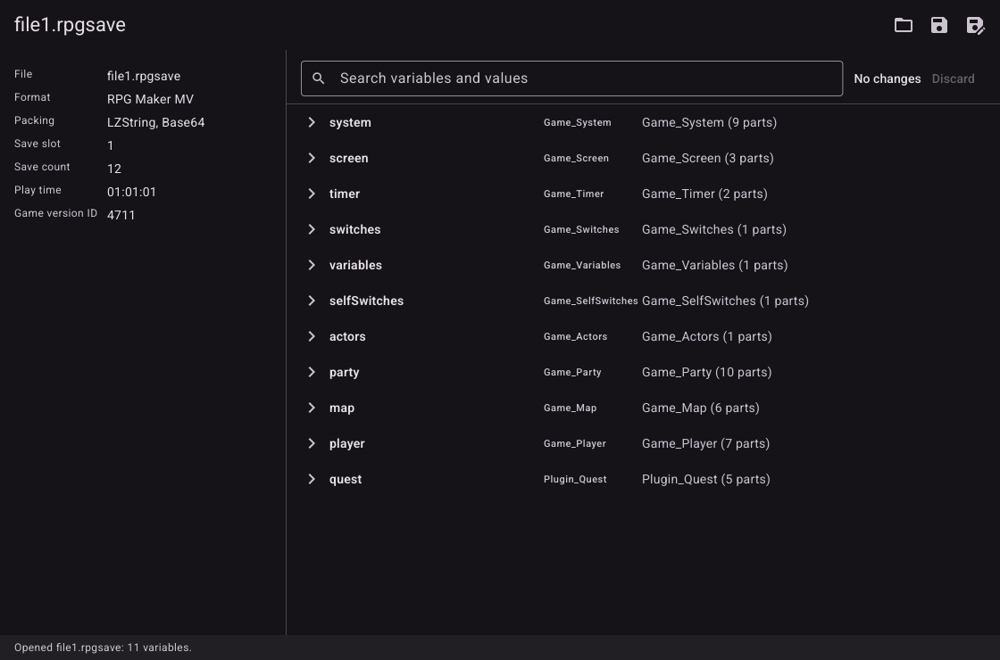
  - MZ: 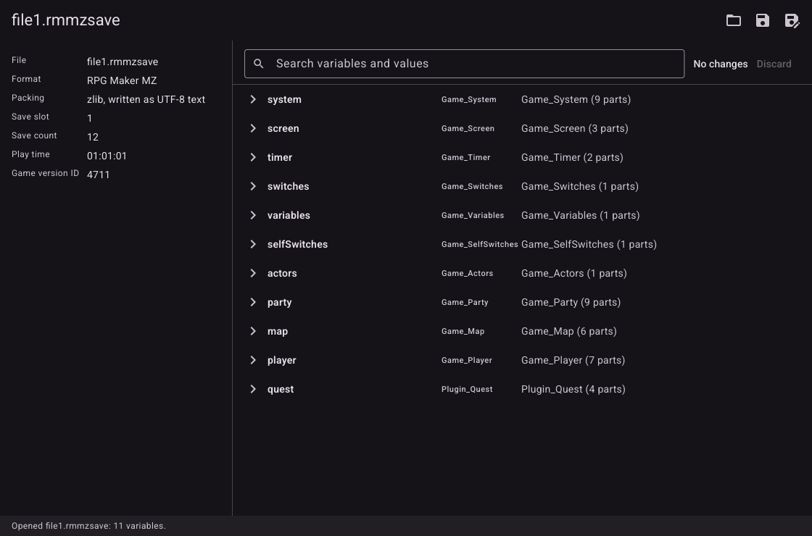
  Both show the file, the format, the packing, the slot, save count, play time and game version, and the tree with the game's classes as types; no Ren'Py parts, no picture, no Internals chip (MV and MZ have no internal variables).
- Open questions for the manager:
  - May the node checks be run against the copies of the engines' scripts that are in the scratchpad (`mvcs-repo`, `mzcs2`)? That is running third-party code, so I did not. It would verify the 1.4 layout detection and the edited files against the engines' own readers.
  - The "(1 parts)" wording is visible again in these screenshots (Step 07).

## Step 04: Unity PlayerPrefs
- Done:
  - `internal/unityprefs/plist.go`, `unityprefs.go`: a real defect found in the review, fixed. A binary plist writer keeps one object for equal numbers, strings and bools (and a string that is a value may be the key of another entry). The package gave all places of one object the same site, so an edit of `Gold` (1500) also changed every other preference holding 1500, and a string that was also a key could not be edited at all. Now every place has its own value and site (`plistRef{index, parent, pos}`). An edit of an object that only one place uses replaces it where it is, as before. An edit of an object that several places use appends a new object and points that one place at it (the reference in its container is rewritten; the other places keep the old object); if the new objects need more bytes per reference than the file has, every container is written again with larger references; the offset size, the reference size, the object count and the offset table position of the trailer are updated. Objects that are not edited keep their bytes, and so do the gaps between them. A dictionary key is still never a site.
  - `registered_test.go` has the three fixtures (`linux.prefs`, `mac-plistlib.plist`, `mac-float32.plist`): detected by exactly one registered format, opened in the app, `Gold` edited and saved, read back with every other value unchanged. `formats.go` registers `unityprefs.Format` last.
  - Tests changed/added in `internal/unityprefs/unityprefs_test.go`: `Name` and `Alias` (a string shared with a key) are now editable; `TestEdits` expects `List` (which shares the objects of `Volume` and `Gold`) to keep its values; `TestPlistKeepsObjects` expects the shared object kept and a new one added; new `TestSharedObjectsAreEditedOnePlaceAtATime` and `TestReferencesGrow` (a 256-object plist with 1-byte references, written by the test, one edit that needs 2-byte references; read back by Go and by Python). Removed an unused helper, replaced a `big.Int` based `itoa` by `strconv.Itoa`.
  - Review of the whole package against SPEC.md and CLAUDE.md: errors made once in the failing function with `errors.New`/`errors.NewErr`, every tag a constant with a route test (UnknownLayout, EditSite, EditKind, EditRange, EditText, XMLInvalid, XMLRoot, PlistInvalid, PlistRoot), no `fmt.Errorf`, no cgo, no global mutable state, exported identifiers documented, `Encode(nil)` gives the original bytes, edits keep the kind and are bounded by the site (ints: 32 bits, 64 bits for a number already outside 32 bits; floats must fit the stored real, 4 or 8 bytes), refused edits tested, truncated and one-byte-changed fixtures never panic (`TestDamagedFilesDoNotPanic`). Unity's own keys (`Screenmanager *`, `UnityGraphicsQuality`, `UnitySelectMonitor`, `unity.*`, and the keys macOS adds: `Apple*`, `com.apple.*`, `NS*`) are Internal and hidden behind the chip.
- Supported / not supported:
  - Linux `~/.config/unity3d/<Company>/<Product>/prefs` (XML, `<pref name type>`: int, float as 32-bit, string as base64 of UTF-8) and macOS `~/Library/Preferences/<bundle id>.plist` as a binary plist (`bplist00`) whose top object is a dictionary (ints, reals of 4 or 8 bytes, strings ASCII or UTF-16, bools; dicts, arrays, data, dates, UIDs are shown read-only). XML edits change only the text of the element (also `<pref ... />` and empty elements). A string that is not UTF-8 is shown as bytes and not edited.
  - Not supported: Windows (registry); a macOS plist in XML or JSON form (only `bplist00`); the file layouts of games that keep PlayerPrefs elsewhere. Detection of a binary plist is by contents, so any binary plist with a dictionary at the top (another application's) is also accepted as Unity PlayerPrefs; the contents cannot tell them apart. The layout of the XML and plist files follows Unity's documentation and a public sample as noted in the package comment; no real Unity file was available here, so it is unverified against a real game's file.
- Checks (whole repository; `RUBYMARSHAL_PYTHON` set to the existing venv):
  - `gofmt -l .`: no output.
  - `go vet ./...`: no output.
  - `golangci-lint run`: 0 issues (after removing the unused helper).
  - `go test -race -count=1 ./...`: all packages ok.
  - `CGO_ENABLED=0 go build ./...`: ok. `CGO_ENABLED=0 go test -count=1 ./...`: ok.
  - Golden image not changed. `pgrep -a Xvfb` and `pgrep -a save-editor`: nothing left.
- Verified against: Python's standard library only. `testdata/load.py` (run with `python3 -I`, `plistlib` for the plist, `xml.etree` and `base64` for the XML) reads every fixture and every edited output, and the Go tests compare the two trees (`TestAgainstPython`, `TestEdits`, `TestOffsetTableGrows`, `TestSharedObjectsAreEditedOnePlaceAtATime`, `TestReferencesGrow`); they ran, none skipped. Nothing from the scratchpad's downloaded folders was run. Not verified against Unity itself or a real file: a user can copy their own `prefs` or `.plist`, open it, change a value, save, and start the game.
- Screenshots (real binary, private Xvfb, `HOME` in a scratch folder):
  - Linux prefs (file named `prefs`): 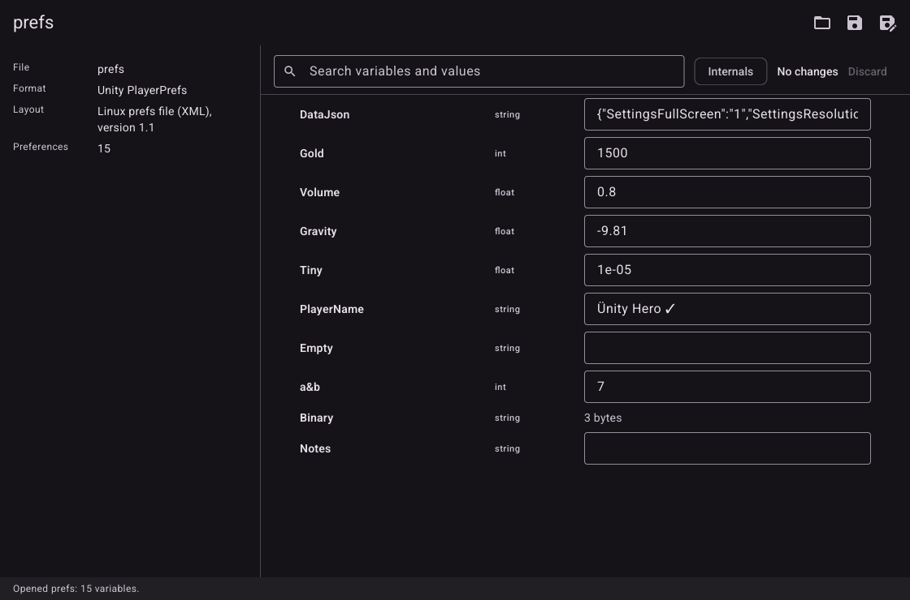
  - macOS plist (copied as `unity.Acme.Hero.plist`): 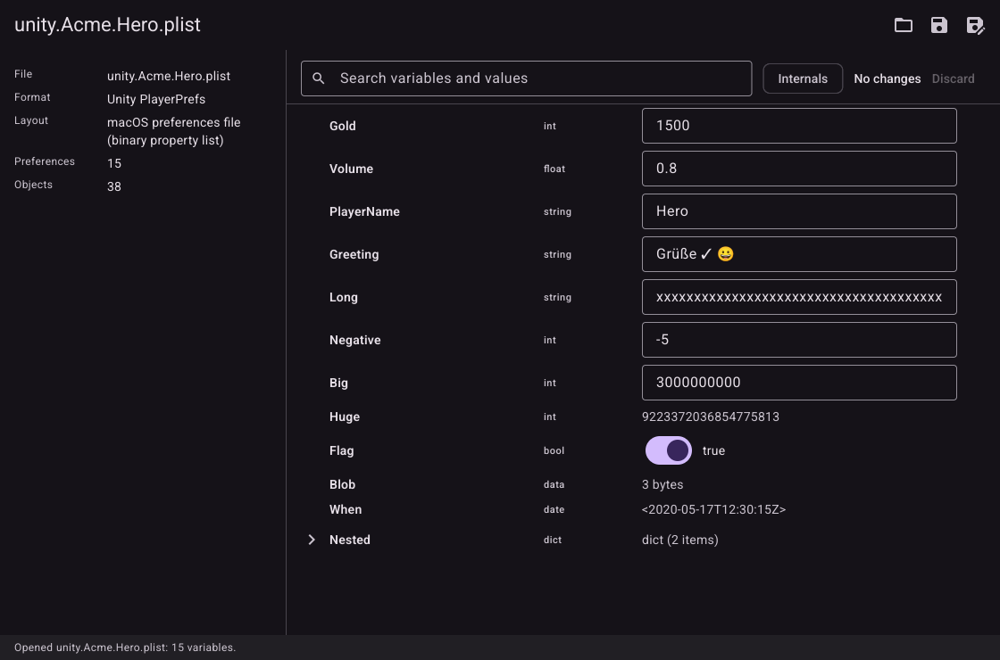
  Both show the format, the layout, the preferences with their types, a read-only blob/date/huge int on the plist, a collapsed dictionary, and the Internals chip (Unity's own keys are hidden).
- Open questions for the manager:
  - Should an edit that splits a shared plist object tell the user? Nothing is shown now; the other places keep their value, which is what a user editing one preference expects.

## Step 05: .NET BinaryFormatter
- Done:
  - `internal/nrbf/parse.go`, `build.go`: reviewed against MS-NRBF and CLAUDE.md, three defects fixed:
    1. A `HashSet<T>` was never shown as its items (the code asked for `math.MaxInt` items of its `Elements` array and rejected the array as too short); it now shows all of `Elements`. A `List<T>` whose `_size` is negative is shown as the class instead of failing.
    2. Memory: a run of nulls (`ObjectNullMultiple`, 6 bytes) stands for up to a million members, and the per-array limit did not bound the total, so a small file could ask for gigabytes. A budget for all members and items together (`maxTotalItems`, 4 Mi; real saves are far below) now ends the parse with `NRBFTooLarge`.
    3. Stack: the reader limits nesting, but a chain of 1 million objects that refer to the next one by `MemberReference` made the model builder recurse a million deep (a fatal stack overflow in Go, not an error). `builder.object` now stops at the same depth limit with `NRBFTooLarge`.
  - Shared objects: a string or class reached from several places (`MemberReference` to the same object id) is one value and one site, as the model contract says and unlike the plist of Step 04: editing the string `Name` also changes `nickname`, and the stream holds that string once. Checked by `TestSharedValues` and the edit tests (`places` compares every place of the tree before and after).
  - `internal/nrbf/nrbf_test.go` (new, it had no tests): detection (the five fixtures; every file in every other package's `testdata`, including GVAS `*.sav`, the Ren'Py saves, LSD, RGSS, MV/MZ, PlayerPrefs and the Python/JS scripts, none detected under any of five names; hand-made near misses: another version, a header only, GVAS magic, zeros), parse of `player.sav` (every primitive type, a list shown as its items and not its capacity, Dictionary and Hashtable by key, HashSet, `int[,]`, nulls, boxed values, qualified names, details), the other fixtures, shared values, round trip, 38 edits (every primitive: bool, byte, sbyte, short, ushort, int, uint, long, ulong, float, double, char of 1, 2 and 3 bytes, decimal, strings from empty to over 127 bytes so that the length prefix grows, in classes, lists, dictionaries, hash sets, grids, jagged and offset arrays, a system class, an array root), each checking that the bytes before and after the value are unchanged, that the output reads back, and that every other place has its old value; several edits at once; the bounds of every whole-number type (the limits accepted and read back, one beyond refused), refused edits (foreign, missing and repeated sites, wrong kinds, out of range, float32 overflow, invalid UTF-8, bad char and decimal text) with routes, the user messages of `CheckText`, 30 parse errors with their tag and route (every one of the seven parse tags and the four edit tags), the item budget and the deep chain above, every prefix and every byte changed of every fixture (never a panic; a document that parses encodes unchanged), type names, member labels, dates and time spans.
  - `testdata/gen.py` now also writes `extra.sav` (a class that is its own parent, a jagged `int[][]`, an offset array with lower bound 5, `System.Version` as a plain system class, a 2-byte char, `ObjectNullMultiple` of 300, an empty array, a shared string, a null string), `array-root.sav` and `string-root.sav` (roots that are not classes); `player.sav` and `spec-address.bin` regenerate byte for byte.
  - `formats.go` registers `nrbf.Format` last. `registered_test.go` has the five fixtures: detected by exactly one registered format (so GVAS `.sav`, Ren'Py `.save` and everything else are not taken), opened in the app, and for `player.sav` and `array-root.sav` an int edited, saved, read back.
- Supported / not supported:
  - BinaryFormatter streams of Unity games (Mono): every record that BinaryFormatter writes (header, library, class with members and types, system class with members and types, class with id, object string, binary array of all six kinds, typed primitive, member reference, null, null multiple, array of primitives, objects, strings, message end). Classes by name with their members; `List`, `ArrayList`, `HashSet`, `Dictionary`, `Hashtable` as items; value edits of bool, all integer types with their exact bounds, float, double, char, decimal and strings, in place. `DateTime` and `TimeSpan` are shown, not edited; a `byte[]` is shown as bytes; a primitive array of more than 65536 items is shown as one opaque value.
  - Not supported: `ClassWithMembers` and `SystemClassWithMembers` (no member types: BinaryFormatter does not write them), method call and return records, streams of Unity's own serializers, files that are encrypted or compressed by the game, and adding or removing items. A string that is not UTF-8 is shown as bytes.
  - Detection is by the header only (record 0, version 1.0, a record type that can follow), with the file name ignored; a file of another format that happens to begin with these 18 bytes would be taken, which no fixture of the repository does.
- Checks (whole repository; `RUBYMARSHAL_PYTHON` set to the existing venv):
  - `gofmt -l .`: no output.
  - `go vet ./...`: no output.
  - `golangci-lint run`: 0 issues.
  - `go test -race -count=1 ./...`: all packages ok.
  - `CGO_ENABLED=0 go build ./...`: ok. `CGO_ENABLED=0 go test -count=1 ./...`: ok.
  - Golden image not changed. `pgrep -a Xvfb` and `pgrep -a save-editor`: nothing left.
- Verified against: no independent reader ran. There is no .NET and no Python reader of NRBF in the standard library, so `player.sav`, `extra.sav` and the two roots are made by `gen.py` from the specification, and a bug shared by `gen.py` and the Go reader (both written from the same reading of the spec) would not show. The one independent artifact is `spec-address.bin`: the bytes of the worked example of section 3 of MS-NRBF (Microsoft's own hex dump, `Address` with Street, City, State, Zip) behind a header; the Go reader gives the four strings the specification says, and an edit of one reads back. A user with .NET or Mono can check a real file: `new BinaryFormatter().Deserialize(File.OpenRead("save.dat"))` before and after an edit in this editor, or open their own Unity save, change a value, save, and start the game.
- Screenshot: 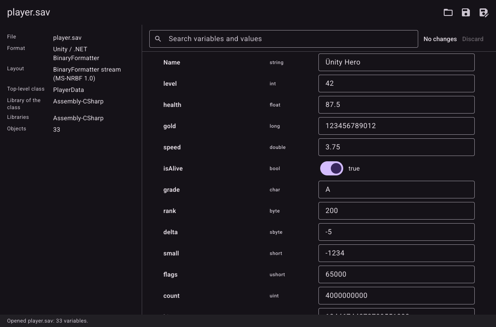 (real binary, private Xvfb, `HOME` in a scratch folder). It shows the format, the layout, the top-level class and its library, and the members with their C# types, switches and text fields.
- Open questions for the manager:
  - The header-only detection means any `.dat` of another game that starts with a BinaryFormatter header is opened (correct), but a hostile file that only imitates the header gets a parse error, which is the intended message. Nothing to decide unless you want a second check.

## Step 06: Unity JSON and Easy Save 3
- Done:
  - New package `internal/unityjson` on `internal/jsondoc`: `unityjson.go` (two formats, `FormatJSON` "Unity JSON" and `FormatES3` "Easy Save 3", the document, the presentation of ES3 entries), `layers.go` (gzip and AES layers, found by their bytes), `testdata/gen.py` and 7 fixtures. Registered in `formats.go` after every other format, ES3 before plain JSON.
  - Easy Save entries `{"__type": T, "value": V}` are shown as V with the C# type T (`int`, `long`, `Vector3`, `List`); the `__type` keys are hidden everywhere and cannot be edited (they stay in the file). Whole numbers are held to the range of their C# type (`byte` 0 to 255, `int` 32 bits, `long` 64 bits, and so on), `float` shows single precision. An entry of another shape (more keys than `value`, no `value`) is shown as an object of its type.
  - Edits: only the bytes of the value are replaced (jsondoc), then the layers are made again in the order they were found: gzip with the header bytes of the original (the 10 byte header is kept; the same level), AES with a new random IV for each write. I chose a new IV rather than the original one: CBC with one IV for two different texts leaks what they share at their start, it costs nothing, and ES3 reads the IV from the first 16 bytes of the file, so any IV is read. The key is derived from the new IV (it is the salt), so the whole file changes; with no edits `Encode` gives the original bytes.
  - A bug found by the tests and fixed: the IV is random, so about 2 in 100 encrypted files begin with a byte that looks like JSON (`{`, `[`, white space, a byte order mark) or gzip. `unwrap` now takes a file of whole blocks for JSON or gzip only when it parses or inflates, and tries it as ciphertext otherwise (`TestIVThatLooksLikeText`; `go test -count=150` is stable).
- Detection (how it decides):
  - Easy Save: the layers are peeled by content, at most 4: JSON text (an object or array, after a byte order mark and white space) ends it; a gzip stream (`1f 8b 08`) is inflated (bounded to 512 MiB); a file of at least 2 whole 16-byte blocks is decrypted with the default password `password`, first block first (the first plaintext block must begin as JSON or gzip), then fully (valid PKCS7 padding and a JSON or gzip result). It is Easy Save's when it had at least one layer, or when it is plain JSON of its shape: an object whose every key holds an object with a text `__type`. Name does not matter for these.
  - Encrypted with an unknown password: the file cannot be told from random bytes by its contents. It is taken as Easy Save only when its name ends in `.es3` (any case) and it has the shape of ciphertext: whole blocks, at least 2, not text, and no byte value making up more than an eighth of it. `Parse` then refuses it with: "This Easy Save 3 file is encrypted with a password other than the default one ("password"), so it cannot be opened" (`UnityJSONEncrypted`). A random file with another name (`.dat`, `.bin`, no name) or with a length that is not a multiple of 16 is not taken by any format ("This file is not a save of a supported engine"). A random file named `.es3` with whole blocks is taken and refused with the message above, which is the price of the rule; an Easy Save file with another password and another name is not recognized.
  - Plain JSON: the contents decide: an object or array that parses and is not Easy Save shaped. A `.json`/`.txt` name only matters for a file that begins as JSON but has a mistake in it, so that `Parse` can show the syntax error with its line and column; with any other name such a file is not taken. It does not take any fixture of the other formats: `TestDetectOthers` runs every file in every other package's `testdata` (65 files) under 7 names; only the `.json`/`.expected` helper texts of other packages (the JSON the MV/MZ tests keep next to their fixtures) are JSON, and are detected as such.
- Supported / not supported:
  - Plain JSON saves (JsonUtility, Json.NET, hand made), Easy Save 3 `.es3` in JSON form, with gzip and/or AES with the default password. Not supported: a password other than `password` (the app has no way to ask for one), Easy Save's binary or other formats, ES3 files that are not strict JSON (the Easy Save tools describe "json-like" text with unquoted numeric keys in some files; such a file gets a JSON syntax error), ES3 key sizes other than 128 bits (one README mentions 256; no source says how a game chooses it), JSON with a number outside the JavaScript safe range of 2^53 in a type that is not a C# whole number type (jsondoc's rule), adding or removing keys.
- Checks (whole repository; `RUBYMARSHAL_PYTHON` set to the existing venv):
  - `gofmt -l .`: no output.
  - `go vet ./...`: no output.
  - `golangci-lint run`: 0 issues.
  - `go test -race -count=1 ./...`: all packages ok.
  - `CGO_ENABLED=0 go build ./...`: ok. `CGO_ENABLED=0 go test -count=1 ./...`: ok.
  - Golden image not changed. `pgrep -a Xvfb` and `pgrep -a save-editor`: nothing left.
  - Tests of the package: detection of every fixture and near miss, every other package's testdata, random bytes, byte order marks, parse (types, hidden keys, details, duplicates), round trip, 13 edits on each of the 4 ES3 layer variants and 6 on plain JSON (the bytes outside the value unchanged, every other place unchanged, the layers of the original kept, the IV changed), bounds of C# types, refused edits (routes), every error tag with its route (including the crypto errors, made by calling `newCipher` with key sizes that fail and `encrypt` with a failing random source, and the gzip size limit through a small limit), layers in either order and twice, the IV that looks like text, odd entries, every prefix and every changed byte of every fixture.
- Verified against:
  - Independent tools that ran: `gen.py` makes the encrypted fixtures with Python's `hashlib.pbkdf2_hmac` (PBKDF2-HMAC-SHA1, salt = IV, 100 iterations, 16 bytes) and the `openssl enc -aes-128-cbc` program (PKCS7), and the gzip with Python's `gzip`; the Go code reads them. In the other direction `TestAgainstOpenssl` has `openssl kdf` derive the key and `openssl enc -d` decrypt the files that this editor writes, and compares the text with the expected JSON (gunzipped for the gzip variant). So the cipher, the padding and the key derivation of this code equal OpenSSL's for the layout described below. `openssl` is a system program, nothing was downloaded.
  - Not verified: that this layout is what Easy Save itself reads and writes. Easy Save is closed source and no real `.es3` file was available. Sources read (no code run or downloaded): the Easy Save 3 guides at docs.moodkie.com (`es3-guides/es3-encryption`: AES with a 128-bit key, gzip as an option, encryption off by default, no password default stated; `es3-api/es3-properties/es3settings-encryptionpassword`: no default stated); the README of github.com/Chaobs/unity-es3-cracker ("IV is the first 16 bytes of the save file", "Key = PBKDF2-HMAC-SHA1(password, salt = IV, iterations = 100, dklen = 16)", `file = IV || AES-CBC(Key, IV).Encrypt(PKCS7(plaintext))`; it also says "AES-128/256" elsewhere); and a summary of `es3_cipher_tool.py` of github.com/fakeyw/EasySave3Tool (PBKDF2-HMAC-SHA1, 100 iterations, 16-byte key, the first 16 bytes of the file are both salt and IV, random IV prepended when encrypting, PKCS7 padding). The two third-party sources agree with each other. The default password `password` comes from IMPLEMENTATION.md; the docs above do not state it. The order of gzip and encryption (gzip inside the encryption) and the JSON dialect of the fixtures (`"key" : {"__type" : ..., "value" : ...}`, tab indented) are from memory of Easy Save, not from a source I could read; the code does not depend on the order (layers are found by content), and the JSON reading is generic. A user can check with their own game: open a real `.es3`, change a value, save, start the game. If a real file does not open, the first things to look at are the password and the iteration count in `layers.go`.
- Screenshot: 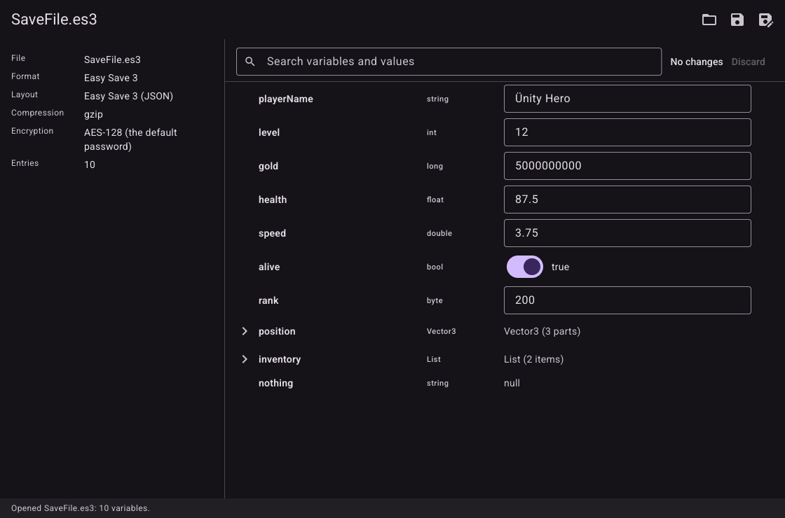 (the `es3-aes-gzip.es3` fixture copied as `SaveFile.es3`: gzip inside AES, opened with the default password; real binary, private Xvfb, `HOME` in a scratch folder). It shows the format, the compression and the encryption layers, and the entries with their C# types.
- Open questions for the manager:
  - The app has no password field, so an ES3 file with a game's own password cannot be opened. Adding one is a change of the app (and of `model.Format`, whose `Parse` takes only name and data), not of this package; say if it is wanted.
  - ES3's real dialect is unverified (see above). If the user can provide one real `.es3` (or a description from their game), the fixtures should be redone from it.

## Step 07: Detection and the app across all formats
- Done:
  - `app.go`: a container with one part reads "(1 part)", as `model.Value.Repr` does (`partsWord`). Before, the row text of an object said "(1 parts)".
  - `fixtures_test.go` (new): `TestEveryFixtureIsDetectedByExactlyItsFormat` takes every file of every `internal/*/testdata` folder (65 files) from a table that says which format detects it: the 14 saves registered before plus the new ones, `es3-other-password.es3` (ES3, refused by `Parse` with a message), the JSON texts of the MV/MZ tests (Unity JSON), and the files that are not saves (key files, `.expected`, pickles, Marshal dumps, a plist whose top is an array, scripts), which no format may take. It runs all 12 registered formats' `Detect` and demands exactly one name, or none. A file that is in `testdata` but not in the table fails the test, so a new fixture cannot be forgotten; a table entry with no file fails too. `TestNoFixtureIsTakenUnderAnotherName` repeats it for every save under 7 other names (`x.dat`, `x.save`, `x.sav`, `x.bin`, `x.json`, `x.txt`, `x`): the contents decide, the answer is the same.
  - `allformats_test.go` (new), app tests on every registered fixture:
    - `TestEveryFormatOpensInTheApp`: the page shows the format name, the details, the status; the Internals chip only for the fixtures that have internal variables (Ren'Py, LSD, RGSS, the PlayerPrefs files with `unity.*`/`Screenmanager` keys) and the document agrees; the picture only for `renpy8.save`; the save name field and the signature card only for Ren'Py.
    - `TestSaveAsOffersTheFormatOfTheDocument`: for each fixture with an editable int, the dialog's filters (`saveFilters` of the page's format) are named after the document's format and one pattern matches the file name; an edit is made, Save as is answered with a new folder, and the new file is read by the same format with the same variables, has no `.bak`, and the first file is unchanged. The fake file dialog of Glutter does not report its filters, so they are checked as the page builds them, not in the dialog.
    - `TestEmptyPageListsEveryFormat` (12 formats), `TestOneObjectPartIsNotParts` (the MV `Game_Actors (1 part)`, no `(1 parts)` anywhere, `Game_Party (10 parts)`), and `TestGoldenOfAnotherEngine`.
  - `testdata/goldens/editor-mv.png` (new): an MV save with the `party` row expanded and `_gold` edited to 9000 (undo button, "1 change", Discard). I looked at it: the left panel has the file, the format, the packing, slot, save count, play time and version; the rows read "(1 part)" and "(9 parts)"; the changed row is highlighted. Stable over 5 runs. `editor.png` (Ren'Py) is unchanged by this step (it was already modified before the plan and its test passes).
- Supported / not supported: nothing new is supported; every format of SPEC section 2 is registered and opens, edits and saves in the app. Not changed: a Ren'Py-only page (save name, signature) still shows for Ren'Py only. Detection facts for the docs: the formats are tried in this order: Ren'Py, GVAS, LSD, XP, VX, VX Ace, MV, MZ, PlayerPrefs, NRBF, Easy Save 3, plain JSON; no fixture is taken by two.
- Checks (whole repository; `RUBYMARSHAL_PYTHON` set to the existing venv):
  - `gofmt -l .`: no output.
  - `go vet ./...`: no output.
  - `golangci-lint run`: 0 issues.
  - `go test -race -count=1 ./...`: all packages ok.
  - `CGO_ENABLED=0 go build ./...`: ok. `CGO_ENABLED=0 go test -count=1 ./...`: ok.
  - `pgrep -a Xvfb` and `pgrep -a save-editor`: nothing left.
- Verified against: no format code changed in this step; the independent checks of Steps 02 to 06 stand. The new tests check detection and the app, not file contents.
- Screenshot: 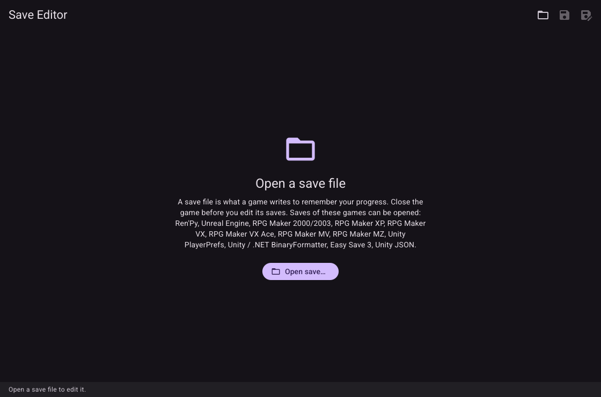: the page without a file, listing the 12 formats (real binary, private Xvfb, `HOME` in a scratch folder, `GLUTTER_SCREENSHOT`).
- Open questions for the manager:
  - The empty page lists the formats in registration order, with "Unity / .NET BinaryFormatter" and "Unity JSON" as names; if the names should be friendlier for users ("Unity (BinaryFormatter)") they are the `Name` fields of the formats.

## Step 08: Documentation
- Done:
  - `README.md` rewritten for all engines: what it opens (a table of games and files), what it does, run it, where the saves are (one entry per engine: Ren'Py, RPG Maker 2000/2003, XP/VX/VX Ace, MV, MZ, Unreal, PlayerPrefs, and the Unity BinaryFormatter, Easy Save 3 and JSON saves), and limits (general, then per engine). The limits say: Easy Save 3 only with the default password `password` (a game's own password cannot be opened, and the editor says so); the MV/MZ, Unreal GVAS, RPG Maker 2000/2003, .NET BinaryFormatter and Easy Save 3 layouts are not verified against the engines themselves; Windows PlayerPrefs (the registry) is not supported; browser-kept MV/MZ saves, game-specific compression or encryption, adding and removing variables are not supported. Two screenshots: the top one is still the Ren'Py golden (`testdata/goldens/editor.png`, no better one exists for it) and a second shows an MV save (`testdata/goldens/editor-mv.png`).
  - `CLAUDE.md`: "Working with agents" is untouched. Project (all engines), Commands (the old generator lines moved to a "Fixture generators" list with every generator: pickle, renpysave, rubymarshal, rgss, lcf, rpgmv, gvas, unityprefs, nrbf, unityjson, and how `gen.js` is run), a new "Reference checks" list (`python3`, `RUBYMARSHAL_PYTHON`, `RPGMV_CORESCRIPT`, `RPGMZ_CORESCRIPT`, `RPGMV_LZSTRING` with `node`, `openssl`; the engines' scripts are third-party code not to run without the user's say-so), Definition of done (the independent reader of each format), Layout (every package and test file), "How saves are edited" (one subsection per format with its in-place rule and its reference), a new short "Adding a format" section (four steps), and the "Don't" about real folders now names the other engines' folders.
  - `SPEC.md` made true to what was built: the table of section 2 has the names of the formats as the app shows them, the registered order, the ES3 default password and key derivation, the MZ UTF-8 detail, and out of scope now lists browser-kept MV/MZ saves and ES3 with a game's own password; section 4 says how plain JSON, Easy Save 3 (including the `.es3` name rule for an unknown password) and BinaryFormatter are detected and that every fixture is detected under any name; section 5 says that a shared value is one site everywhere except in a binary plist (a new object is added for the place that is edited), and that ES3 is written back with its layers; section 6 has "(1 part)"; section 7 lists what is not verified against the engine or a real file.
  - No code changed.
- Supported / not supported: unchanged (see the README limits).
- Checks (whole repository; `RUBYMARSHAL_PYTHON` set to the existing venv): `gofmt -l .` no output; `go vet ./...` no output; `golangci-lint run` 0 issues; `go test -race -count=1 ./...` all packages ok; `CGO_ENABLED=0 go build ./...` and `CGO_ENABLED=0 go test -count=1 ./...` ok; `pgrep -a Xvfb` and `pgrep -a save-editor` nothing left.
- Verified against: the documents were checked against the code and the earlier entries of this file. The places of the saves in the README (RPG Maker file names, Unity's `persistentDataPath`, Unreal's `Saved/SaveGames`, PlayerPrefs paths) are from the engines' documented conventions and the code of the formats, not from a real installation: no real game folder was read. They are worded as "usually".
- Screenshot: none new (the README uses the two goldens, `editor.png` and `editor-mv.png`, already looked at).
- Open questions for the manager:
  - The README says "Go 1.27 or newer" and `go run github.com/rm4n0s/save-editor@latest`, as before; the module is not published with these formats yet, so that line is true only after a release.

## Step 09: Final check
- Done:
  - The full Definition of done on the whole repository (results below), and every registered fixture opened once in the real app: 35 files (all 34 saves of the table in `registered_test.go`, plus `es3-other-password.es3`, which is meant to be refused), one private Xvfb, one process group each under `timeout -k`, `HOME` in a scratch folder, `GLUTTER_SCREENSHOT`. Every run exited 0 and its log has no error or panic (the only "error" words are Mesa's DRI3 warning and Glutter's note that Vulkan has no device, after which it uses OpenGL ES). I looked at all 35 screenshots in contact sheets of four: every page shows the file, the format, the details and the tree as expected for its engine; the Internals chip is there only where a file has internal variables; the picture and the save name and signature card only for Ren'Py (`renpy8.save` has a picture; `renpy7.save` is "Not signed", `friend.save` "Signed on another computer"); "(1 part)" reads right; no row is garbled or cut. Nothing looked wrong, so no screenshot of a fixture is kept. One is kept, because it is the one intended refusal: [`es3-other-password.es3`](docs/screenshots/step-09-es3-other-password.png), the empty page with the red status "Cannot open es3-other-password.es3: This Easy Save 3 file is encrypted with a password other than the default one ("password"), so it cannot be opened".
  - Clean up: no scratch files were made inside the repository; the only artifact was a gitignored 59 MB binary `save-editor` in the root (from `go build ./`), which I deleted. `git status` shows only intended files: the modified `CLAUDE.md`, `README.md`, `app.go`, `app_test.go`, `go.mod`, `go.sum`, `main.go`, `tree.go`, `tree_test.go`, `internal/renpysave/save.go`, `save_test.go`, `testdata/goldens/editor.png`, and the new `SPEC.md`, `IMPLEMENTATION.md`, `IMPLEMENTED.md`, `formats.go` and the test files at the root, `internal/{gvas,jsondoc,lcf,model,nrbf,rgss,rpgmv,rubymarshal,unityjson,unityprefs}/`, `internal/renpysave/document*.go`, `docs/screenshots/` (12 PNGs), `testdata/goldens/editor-mv.png`. No `.bak`, log, binary or `__pycache__`. Nothing is committed (commits are made only when the user asks).
- Checks (whole repository; `RUBYMARSHAL_PYTHON` set to the existing venv):
  - `gofmt -l .`: no output.
  - `go vet ./...`: no output.
  - `golangci-lint run`: 0 issues.
  - `go test -race -count=1 ./...`: all 13 packages ok. The only skipped tests are the engine checks that need the engines' own scripts (`TestFixturesAgainstTheEngine` x6, `TestLZStringAgainstJavaScript`, and the engine read inside `TestEdits`), as agreed.
  - `CGO_ENABLED=0 go build ./...` and `CGO_ENABLED=0 go test -count=1 ./...`: ok. `go mod tidy`: no change.
  - `pgrep -a Xvfb`, `pgrep -a save-editor`, `pgrep -a node`: nothing left.
- What works (all checked by tests and by the real app on fixtures): the 12 formats (Ren'Py, Unreal Engine, RPG Maker 2000/2003, XP, VX, VX Ace, MV, MZ, Unity PlayerPrefs, Unity / .NET BinaryFormatter, Easy Save 3, Unity JSON) are detected by their contents (every one of the 65 files in the `testdata` folders by exactly its own format, under 7 names), shown as a tree with their details, edited in place (the bytes outside the edited value, and everything that does not depend on it, stay as they were), checked against the bounds of the stored type, saved with a `.bak`, saved as, read back before writing, and a damaged or truncated file never panics. Ren'Py saves are re-signed with the user's key. Easy Save 3 is written back with its gzip and AES layers (a new IV each time).
- What is unverified against an independent tool, per engine:
  - **Ren'Py**: checked against Python (`pickle`, `load.py`) and Ren'Py's own `ecsign.py` (the fixtures are signed with it). Not checked: a real game's save, and a game that loads it.
  - **RPG Maker XP, VX, VX Ace** (and Ruby Marshal): agree with the Python package `rubymarshal` on every fixture and every edited file (ran here). The order of the dumps is that of the default scripts as quoted by scripters; a game with changed scripts shows the extra dumps as "extra N". No real game's save.
  - **RPG Maker 2000/2003**: a second reader written in `gen.py dump` from EasyRPG's liblcf checks the first, but both come from the same reading of liblcf; no EasyRPG tool and no real save.
  - **RPG Maker MV and MZ**: the fixtures were made by the engines' own scripts in an earlier session, and the MZ disk layout was decided from `rmmz_managers.js`; the node checks against the engines did not run in this work (third-party code, by decision). The LZString layout of version 1.4 and later is checked against the Go compressor only.
  - **Unreal Engine**: only the fixtures and `.expected` files of `gen.py`, written from the open readers' descriptions; no Unreal and no `uesave`.
  - **Unity PlayerPrefs**: Python's `plistlib` and `xml.etree` read the fixtures and the edited files; the layouts are from Unity's documentation and a public sample. No real Unity file.
  - **.NET BinaryFormatter**: one independent artifact, Microsoft's example of section 3 of MS-NRBF; the rest is from `gen.py`, written from the same specification. No .NET and no real file.
  - **Easy Save 3**: the cipher, the key derivation and the padding are checked against OpenSSL, Python's `hashlib` and `gzip`; that these are what Easy Save uses (IV first, PBKDF2-HMAC-SHA1, 100 iterations, 16 bytes, gzip inside the encryption, the default password `password`, the JSON dialect) comes from two third-party descriptions and memory, not from Easy Save. Only the default password is supported.
  - **Plain JSON**: checked against Go's `encoding/json` (`internal/jsondoc`), which is the independent reader there.
- What a user should test with real saves (make a copy first; the editor also keeps `<file>.bak`): open the save, change one number, save, and load it in the game; if it loads and shows the change, try a text, a switch and a nested value; then try an edit that changes the length of a text.
  - Ren'Py: do it with and without the Ren'Py key file chosen; check that the game does not ask about the signature; a variable the game changed on the line it saved on may come back (rollback), save a click later.
  - RPG Maker 2000/2003, XP, VX, VX Ace: gold, an actor's level and HP, a switch; a game with its own scripts (extra dumps, changed classes).
  - RPG Maker MV and MZ: `file1` and `global`; a game with plugins; then run the node checks of `CLAUDE.md` with the engines' scripts if you have them (`RPGMV_CORESCRIPT`, `RPGMZ_CORESCRIPT`, `RPGMV_LZSTRING`).
  - Unreal Engine: a save of a UE4 and a UE5 game, including one with arrays, maps or structs of its own; a game that wraps its saves is refused.
  - Unity PlayerPrefs: the Linux `prefs` or the macOS `.plist` of a game, with the game closed (macOS caches preferences: log out of the game and, if the change does not show, restart `cfprefsd`).
  - Unity BinaryFormatter, JSON and Easy Save 3: the game's own save; for Easy Save a file with and without encryption and gzip; a file with the game's own password is refused, and so is any change the editor cannot read back.
- Screenshot: the kept one is linked above. The app on each of the 35 fixtures was looked at and is as described.
- Open questions for the manager:
  - None. The decisions left to the user (a password field for Easy Save 3; running the engines' scripts for the MV/MZ checks; a real save of each engine to confirm the layouts) are listed above.
