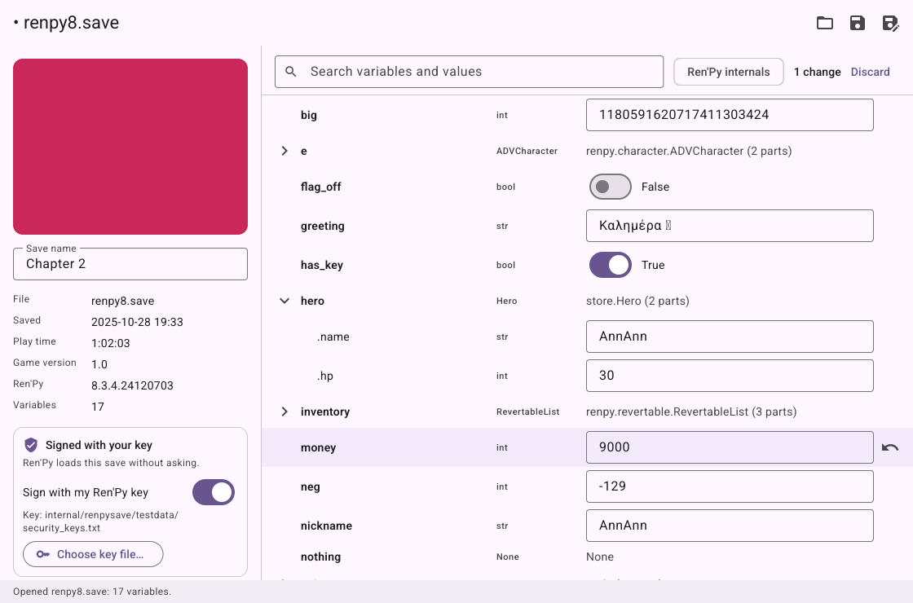

# Ren'Py Save Editor

A desktop editor for the save files of [Ren'Py](https://www.renpy.org) games. Open a `.save`, change the
money, the names, the flags and the stats the game keeps, and save it again. Everything happens on your
computer; nothing is uploaded.



It is written in Go with [Glutter](https://github.com/rm4n0s/glutter), so it is one program with no runtime
to install.

## What it does

- **Every variable of the game**, as a tree: numbers, text and true/false values can be edited; lists, dicts,
  sets and the game's own objects (inventories, characters, stats) open to show their parts, which can be
  edited the same way.
- **Search** by name or by value, and a switch for Ren'Py's own variables (the ones whose names start with `_`).
- **Changes are marked** until you save, each one can be undone, and a value that is not a number where a
  number belongs is refused before anything is written.
- **The save's details**: its screenshot, its name (which you can change), the time it was made, the play time,
  and the versions of the game and of Ren'Py.
- **Signatures.** Since Ren'Py 7.6 and 8.1 every save is signed with a key that Ren'Py keeps for your user
  account. The editor signs the edited save with that key (it finds `security_keys.txt` in Ren'Py's folder, or
  you choose the file), so the game loads it without asking. Without the key, the old signature is removed and
  Ren'Py asks once whether to load the save; a save that kept its old signature would be refused.
- **Safe writes.** The first time a save is overwritten, the original is kept next to it as `<name>.save.bak`,
  and the file is replaced only after the new one is fully written. Only the bytes of the values you changed
  are different: everything else in the save, including the classes of the game, is left as it was.
- Ren'Py 8 (Python 3) and Ren'Py 7 (Python 2) saves.

## Run it

You need Go 1.27 or newer:

```
go run github.com/rm4n0s/save-editor@latest
```

or from a clone, `go run . [file.save]`. Build a binary with `go build` (`CGO_ENABLED=0` works).

Shortcuts: Ctrl+O opens, Ctrl+S saves, Ctrl+Shift+S saves as.

## Where the saves are

A game keeps a copy of each save in two places:

- the `game/saves` folder of the game, and
- Ren'Py's folder for your account, under the game's name: `~/.renpy/<game>/` on Linux,
  `%APPDATA%\RenPy\<game>\` on Windows, `~/Library/RenPy/<game>/` on macOS.

Edit either copy: the game loads the one with the newest modification time, which is the one you just saved.
Close the game first, so it does not write the save again over your edit.

The key that signs saves is `tokens/security_keys.txt` in the same Ren'Py folder.

## Limits

- When Ren'Py loads a save, it sets every variable and then rolls back to the beginning of the line the game
  was saved on. A variable the game changed *on that line* gets its earlier value back from the rollback
  history. If an edit does not stick, save the game one click later, at a quiet moment, and edit that save.
- Values are edited in place, with their type: a number stays a number. Variables cannot be added or removed,
  and the keys of a dict cannot be renamed.
- Games that check their own data (a checksum of the stats, for example) may notice an edit.

## Development

See [CLAUDE.md](CLAUDE.md) for the commands, the checks a change must pass, and how saves are read and written.

## License

MIT, see [LICENSE](LICENSE).
