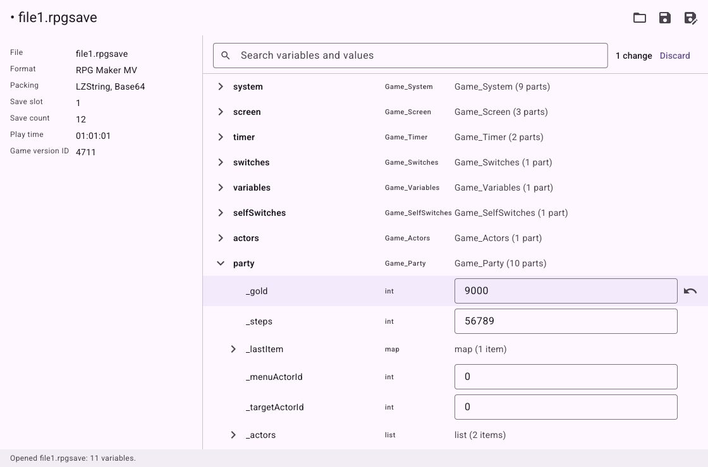

# Save Editor

A desktop editor for the save files of games. Open a save, change the money, the names, the flags and the
stats the game keeps, and save it again. Everything happens on your computer; nothing is uploaded.


It is written in Go with [Glutter](https://github.com/rm4n0s/glutter), so it is one program with no runtime
to install.

## What it opens

| Game or engine | Files |
|---|---|
| [Ren'Py](https://www.renpy.org) 7 and 8 | `*.save` |
| RPG Maker 2000 and 2003 (and EasyRPG Player) | `Save*.lsd` |
| RPG Maker XP, VX and VX Ace | `*.rxdata`, `*.rvdata`, `*.rvdata2` |
| RPG Maker MV and MZ | `*.rpgsave`, `*.rmmzsave` |
| Unreal Engine 4 and 5 | `*.sav` (`SaveGame` files, which begin with `GVAS`) |
| Unity, PlayerPrefs | `prefs` (Linux), `*.plist` (macOS) |
| Unity, .NET `BinaryFormatter` | any name: `.dat`, `.sav`, `.bin`, ... |
| Unity, Easy Save 3 | `*.es3` (JSON, optionally gzip, optionally AES with the default password) |
| Unity, JSON | `*.json` and any JSON text |

The editor recognizes a file by what is in it, not by its name, so a save with an unusual name still opens.



## What it does

- **Every variable of the game**, as a tree: numbers, text and true/false values can be edited; lists, dicts,
  sets and the game's own objects (inventories, characters, stats) open to show their parts, which can be
  edited the same way.
- **Search** by name or by value, and a switch for the engine's own variables (Ren'Py's names that start with
  `_`, Unity's screen settings, RPG Maker's bookkeeping).
- **Changes are marked** until you save, each one can be undone, and a value that does not fit (a text where a
  number belongs, a number too large for its type) is refused before anything is written.
- **The save's details**: for a Ren'Py save its screenshot, its name (which you can change), the time it was
  made, the play time and the versions of the game and of Ren'Py; for the other engines what the file says
  about itself (the play time and the party of an RPG Maker save, the engine version of an Unreal save, ...).
- **Ren'Py signatures.** Since Ren'Py 7.6 and 8.1 every save is signed with a key that Ren'Py keeps for your
  user account. The editor signs the edited save with that key (it finds `security_keys.txt` in Ren'Py's
  folder, or you choose the file), so the game loads it without asking. Without the key, the old signature is
  removed and Ren'Py asks once whether to load the save; a save that kept its old signature would be refused.
- **Safe writes.** The first time a save is overwritten, the original is kept next to it as `<name>.bak`, and
  the file is replaced only after the new one is fully written. Only the bytes of the values you changed are
  different (and what has to follow from them, such as a length, a size or the compression around the file):
  everything else in the save, including the classes of the game, is left as it was. The result is read back
  before it is written, and is not written if it does not read.

## Run it

You need Go 1.27 or newer:

```
go run github.com/rm4n0s/save-editor@latest
```

or from a clone, `go run . [file]`. Build a binary with `go build` (`CGO_ENABLED=0` works).

Shortcuts: Ctrl+O opens, Ctrl+S saves, Ctrl+Shift+S saves as.

## Where the saves are

Close the game first, so it does not write the save again over your edit. These are the usual places; a game
can keep its saves elsewhere.

- **Ren'Py.** A game keeps a copy of each save in two places: the `game/saves` folder of the game, and Ren'Py's
  folder for your account, under the game's name: `~/.renpy/<game>/` on Linux, `%APPDATA%\RenPy\<game>\` on
  Windows, `~/Library/RenPy/<game>/` on macOS. Edit either copy: the game loads the one with the newest
  modification time, which is the one you just saved. The key that signs saves is `tokens/security_keys.txt` in
  the same Ren'Py folder.
- **RPG Maker 2000 and 2003.** `Save01.lsd` to `Save15.lsd` in the game's folder, next to `RPG_RT.exe`.
- **RPG Maker XP, VX and VX Ace.** `Save1.rxdata` and so on (XP), `Save01.rvdata` (VX), `Save01.rvdata2` (VX Ace),
  in the game's folder.
- **RPG Maker MV.** `file1.rpgsave`, `global.rpgsave` and `config.rpgsave` in the `save` folder of the game's
  `www` folder (the `save` folder of the game on some packages). A game played in a web browser keeps its saves
  in the browser, not in files, and cannot be opened.
- **RPG Maker MZ.** `file1.rmmzsave`, `global.rmmzsave` and `config.rmmzsave` in the `save` folder of the game.
- **Unreal Engine.** `*.sav` files in `Saved/SaveGames` of the game's folder for your account: usually
  `%LOCALAPPDATA%\<Game>\Saved\SaveGames` on Windows (inside the Proton prefix of the game on Linux, under
  `drive_c/users/steamuser/AppData/Local`), and `~/.config/Epic/<Game>/Saved/SaveGames` on Linux and
  `~/Library/Application Support/Epic/<Game>/Saved/SaveGames` on macOS for games that run natively.
- **Unity, PlayerPrefs.** Linux: `~/.config/unity3d/<Company>/<Product>/prefs`. macOS:
  `~/Library/Preferences/unity.<Company>.<Product>.plist` (`com.<Company>.<Product>.plist` in newer Unity
  versions). Windows keeps them in the registry, which is not a file: not supported.
- **Unity, BinaryFormatter, Easy Save 3 and JSON saves.** The game chooses the name; the folder is usually
  Unity's `persistentDataPath`: `~/.config/unity3d/<Company>/<Product>/` on Linux,
  `%USERPROFILE%\AppData\LocalLow\<Company>\<Product>\` on Windows,
  `~/Library/Application Support/<Company>/<Product>/` on macOS. Easy Save's default file is `SaveFile.es3`.

## Limits

- Values are edited in place, with their type: a number stays a number, and a number is held to the range its
  type can store. Variables cannot be added or removed, and the keys of a dict cannot be renamed.
- Games that check their own data (a checksum of the stats, for example) may notice an edit.
- **Ren'Py.** When Ren'Py loads a save, it sets every variable and then rolls back to the beginning of the line
  the game was saved on. A variable the game changed *on that line* gets its earlier value back from the
  rollback history. If an edit does not stick, save the game one click later, at a quiet moment, and edit that
  save.
- **RPG Maker MV and MZ.** Saves that a game keeps in a browser's storage cannot be opened; a game with a plugin
  that compresses or encrypts its saves differently is not recognized. Whole numbers are held to what
  JavaScript keeps exactly (up to 2^53). The layout is the one the engines' scripts write, but the editor has
  not been checked against the engines themselves.
- **RPG Maker 2000 and 2003.** A part of a save that the editor does not know (a patched game, an extension) is
  kept as it is and shown as bytes. Not checked against EasyRPG's own tools.
- **Unreal Engine.** The file must begin with `GVAS`: a game that compresses or encrypts its saves is not
  supported. A value of a type the editor does not know is kept as bytes. Not checked against Unreal itself.
- **Unity, PlayerPrefs.** Only the Linux XML file and the macOS binary property list; the Windows registry is not
  supported. A macOS file that stores equal numbers once is edited one place at a time.
- **Unity, BinaryFormatter.** Method call records and classes without member types (which `BinaryFormatter` does
  not write) are not read; dates and time spans are shown, not edited. Not checked against .NET.
- **Unity, Easy Save 3.** Only with the default password (`password`) of Easy Save's settings: a file encrypted
  with the game's own password cannot be opened, and the editor says so. The file layout is taken from public
  descriptions and has not been checked against Easy Save itself. Easy Save's non-JSON formats are not
  supported.
- Saves that a game wraps in its own encryption or compression, and saves in a game's own binary layout, are
  not supported.

## Development

See [CLAUDE.md](CLAUDE.md) for the commands, the checks a change must pass, how saves are read and written, and
how to add a format; [SPEC.md](SPEC.md) says what the app does and [IMPLEMENTED.md](IMPLEMENTED.md) what was
built and checked.

## License

MIT, see [LICENSE](LICENSE).
